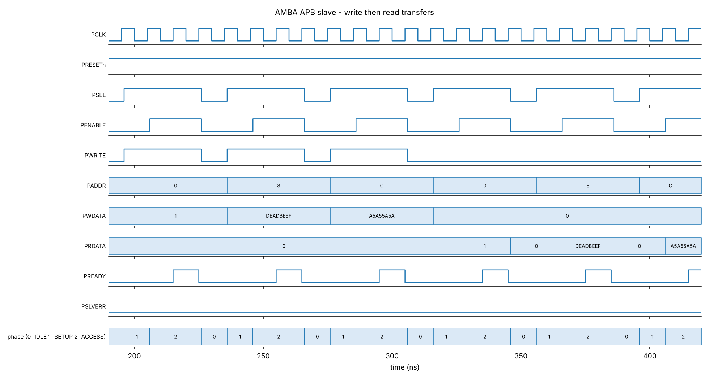

# AMBA APB Slave Peripheral Controller

A synthesizable AMBA APB3 slave written in SystemVerilog. It has a small memory-mapped register file, address decoding, optional wait states and `PSLVERR` error reporting. A self-checking testbench drives it as an APB master and compares every response against a reference model.



The waveform above shows three writes (CTRL, DATA, SCRATCH) followed by three reads, with one wait state inserted. Each transfer is one SETUP cycle followed by two ACCESS cycles.

## Overview

APB is the simple, non-pipelined bus in the Arm AMBA family, normally used for configuration registers and slow peripherals. Every transfer has two phases:

- **SETUP**: the master asserts `PSEL` with `PENABLE` low and drives `PADDR`, `PWRITE` and `PWDATA`. This lasts one cycle.
- **ACCESS**: the master raises `PENABLE`. The transfer completes on the clock edge where `PSEL`, `PENABLE` and `PREADY` are all high. If `PREADY` is low, the master waits.

This design is the slave side. Writes take effect at the completing edge of the ACCESS phase, and reads return `PRDATA` in that same cycle.

## Register map

| Offset | Name    | Access | Description                                          |
|--------|---------|--------|------------------------------------------------------|
| 0x00   | CTRL    | RW     | Control register                                     |
| 0x04   | STATUS  | RO     | `[7:0]` completed writes, `[15:8]` completed reads   |
| 0x08   | DATA    | RW     | General-purpose data register                        |
| 0x0C   | SCRATCH | RW     | Scratch register                                     |

`PSLVERR` is asserted in the final ACCESS cycle for an unmapped or misaligned address, or for a write to STATUS. A write that errors changes nothing, and a read that errors returns 0. STATUS counts only transfers that completed without error.

## Parameters

| Parameter     | Default | Meaning                                              |
|---------------|---------|------------------------------------------------------|
| `ADDR_W`      | 8       | Address width                                        |
| `DATA_W`      | 32      | Data width (must be at least 16)                     |
| `WAIT_STATES` | 0       | Extra ACCESS cycles with `PREADY` held low           |

## Design notes

The RTL is in `rtl/apb_slave.sv`.

- The transfer phase (IDLE, SETUP or ACCESS) is decoded combinationally from `PSEL` and `PENABLE`, so the slave has no state machine of its own.
- A `case` statement on `PADDR` selects the register, flags invalid addresses, and marks STATUS as read-only.
- A small counter holds `PREADY` low for `WAIT_STATES` cycles of ACCESS before raising it.
- Writes and the read/write counters update only when `PSEL && PENABLE && PREADY`, so nothing changes during SETUP or while waiting.
- Registers use an asynchronous active-low reset (`PRESETn`).

## Verification

The testbench is `tb/tb_apb_slave.sv`.

- `apb_xfer` is a master task that produces the SETUP and ACCESS phases and waits for `PREADY`.
- A scoreboard model predicts the read data, `PSLVERR`, and the number of ACCESS cycles for each transfer.
- Directed tests cover reset values, write and readback, register independence, the STATUS counters, error responses, data patterns, and asynchronous reset.
- A random test runs 300 reads and writes across valid and invalid addresses.
- A protocol monitor runs throughout. It flags `PENABLE` without `PSEL`, `PREADY` or `PSLVERR` outside the ACCESS phase, and any register changing before the end of an ACCESS phase.

Results: 844 checks and 0 failures with `WAIT_STATES` set to 0, 1 and 3.

I also checked that the testbench can fail by temporarily breaking the design in five ways: no `PSLVERR` on a STATUS write, a broken SCRATCH write, writing during SETUP, ignoring `PREADY`, and a stuck read counter. The testbench reported failures for each one.

For synthesis, a generic Yosys run (`docs/yosys_synth.log`) reports no problems and no latches, about 480 cells, and 120 flip-flops. I have not run it through an FPGA or ASIC toolchain.

## Repository layout

```
rtl/apb_slave.sv       APB slave
tb/tb_apb_slave.sv     self-checking testbench
docs/plot_wave.py      renders docs/waveform.png from the VCD
docs/waveform.png      example waveform
docs/yosys_synth.log   Yosys synthesis report
Makefile               build and run targets
```

## Running the simulation

You need [Icarus Verilog](https://steveicarus.github.io/iverilog/) 12 or newer. GTKWave is optional, for viewing waveforms.

With `make`:

```
make                # 0 wait states
make WAIT=3         # 3 wait states
make all_waits      # 0, 1 and 3
make wave           # open the waveform in GTKWave
```

Without `make`:

```
mkdir build
iverilog -g2012 -Ptb_apb_slave.WAIT_STATES=0 -o build/sim.out rtl/apb_slave.sv tb/tb_apb_slave.sv
cd build
vvp sim.out
gtkwave apb_slave.vcd
```

A passing run ends with:

```
Checks run : 844
Failures   : 0
RESULT: *** ALL TESTS PASSED ***
```

## Limitations

- This is APB3. It does not implement the APB4 `PSTRB` byte strobes or `PPROT`.
- Only one clock domain is supported, and there is no bridge or master RTL. The master exists only as testbench tasks.